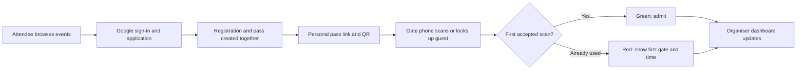
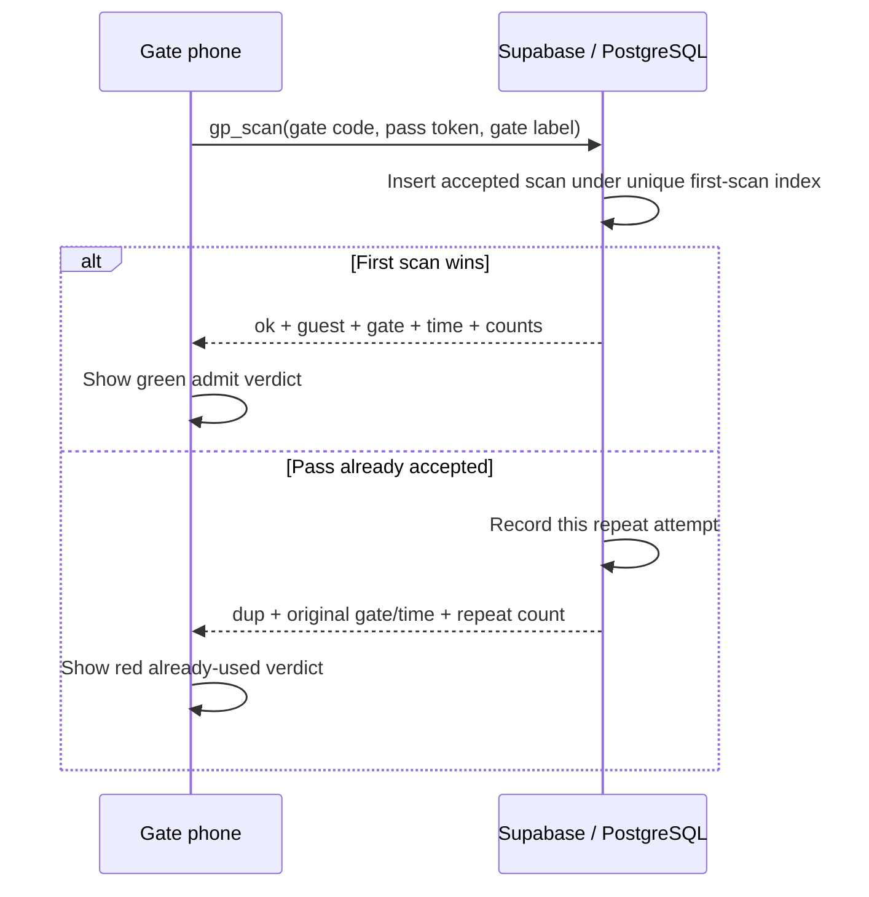
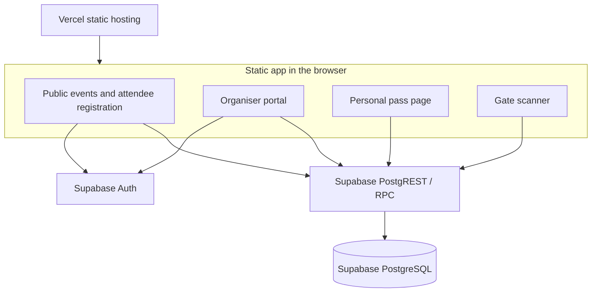

<div align="center">
  
  <h1>GATEPASS</h1>
  <p><strong>One pass. One first scan. No second guessing at the door.</strong></p>
  <p>Free, open-source event registration and QR entry for campus clubs, fests, and community nights.</p>
  <p>
    
    
    
  </p>
</div>

<p align="center">
  <a href="#attendee-experience">Attendees</a> ·
  <a href="#organiser-portal">Organisers</a> ·
  <a href="#gate-scanner">Gate scanner</a> ·
  <a href="#self-hosting">Self-hosting</a>
</p>

---

## The whole door, in one flow

GatePass takes an event from sign-up to check-in. Attendees apply online, organisers manage the guest list, and staff scan passes on their own phones. The first valid scan admits the guest; later scans show exactly when and where that pass was first used.



## Three roles. No extra gate accounts.

| | Attendee | Organiser | Gate staff |
|---|---|---|---|
| **Where** | `/` | `/host/` | `/gate/` |
| **Sign-in** | Google to apply; browsing and pass viewing are public | Google | None; join with the event’s gate code |
| **Main task** | Apply, then show the QR on a phone or screenshot | Create events, manage attendees and watch check-ins | Scan passes, find a guest, and see recent activity |

A pass opens at `/p/#<pass-token>`. The link itself is the credential for that one pass; it doesn’t reveal the attendee’s phone or email.

---

## Made for real event nights

<div align="center">
  <table>
    <tr>
      <td align="center"><br><strong>Concerts & fests</strong></td>
      <td align="center"><br><strong>DJ nights</strong></td>
      <td align="center"><br><strong>Open mic</strong></td>
    </tr>
    <tr>
      <td align="center"><br><strong>Dance shows</strong></td>
      <td align="center"><br><strong>Live music</strong></td>
      <td align="center"><br><strong>Hackathons</strong></td>
    </tr>
  </table>
  <sub>Six built-in poster artworks. Pick one when you make or edit an event.</sub>
</div>

---

## Attendee experience

1. **Browse events.** The home page shows each event’s name, club, date, venue, and artwork. Past events are marked ended.
2. **Choose an event.** Applying requires Google sign-in. If sign-in interrupts an application, GatePass remembers the selected event and form draft for up to 30 minutes so the attendee can continue after returning.
3. **Complete the application.** The form collects a full name, phone number, SAN/USN, semester, and branch. Email is optional. Input is checked in the browser and validated again in the database.
4. **Receive the pass immediately.** A successful application creates the registration and its pass in one database transaction. The attendee gets an on-screen QR and can open the dedicated pass page.
5. **Come back later.** A signed-in attendee sees their registered events and can open their pass again. The ticket can also be copied or screenshotted; only its first successful scan is accepted.

GatePass prevents a second application from the same signed-in account for the same event. It also enforces one SAN/USN per event. A repeat submit returns the original pass when it already exists.

### The personal pass page

The pass page turns the link token into a printable ticket with the attendee’s name, event, date, venue, and QR. It shows a checked-in stamp with the first scan time and gate after admission, includes a **Copy pass link** action, and asks supported mobile browsers to keep the screen awake while the pass is open.

The QR encodes the pass URL. A screenshot is still the same pass, so it works for presentation but cannot be used twice.

---

## Organiser portal

Sign in at `/host/` with Google. The portal is designed around the event and the door list, with light and dark themes.

The theme switch is available across the attendee, organiser, pass, and gate pages. GatePass remembers the choice in that browser.

### Create and edit events

Set the event name, club, date, time, venue, and poster artwork. The portal lists your events with pass and checked-in counts. You can return to edit event details, rotate the gate code, or delete an event and its associated data.

### Build a guest list two ways

**Public applications** arrive as attendee registrations. The Registrations panel supports search by name, SAN/USN, or phone; branch and semester filters; 25-row paging; visible-page selection; bulk deletion; and a CSV export.

**Spreadsheet import** is useful for existing sign-up sheets. Upload a CSV, TSV, or text file, or paste cells from Google Sheets or Excel. GatePass:

- Detects common name, phone, and email headers and suggests the columns.
- Lets you choose the name and contact columns and preview sample rows before generating passes.
- Skips blank names and duplicate name/contact pairs, including people already on that event’s pass list.
- Accepts up to 5,000 rows per import; uploaded files are limited to 4 MB.
- Inserts passes in batches and reports progress while they are created.

### Deliver and manage passes

Each pass gets its own unguessable link and QR. The organiser can search the pass list, copy all links, or export the pass list as CSV. Individual contact actions open the organiser’s email app or WhatsApp with a prepared message; **GatePass does not send messages or emails itself**.

The pass export includes names, contacts, links, and check-in details. The registration export contains attendee application fields. Treat downloaded exports as event records.

### Keep an eye on the door

The event view shows passes, accepted check-ins, and repeat attempts. New scans update the organiser through Supabase Realtime; the portal also refreshes event data periodically. The dashboard includes the gate code, a QR/link for staff to join, and a one-tap code rotation. Rotating the code immediately makes the old code invalid.

---

## Gate scanner

Open `/gate/` on each staff phone. Enter the event’s eight-character code, choose a gate label such as Gate 1 or Desk, and open the scanner. No staff account is needed.

- **Live QR scan:** Uses the browser’s `BarcodeDetector` where available and the bundled `jsQR` decoder as a fallback.
- **Camera controls:** Switch between cameras and turn on the torch on devices that support those controls.
- **Photo fallback:** Select a saved pass image when the live camera is unavailable.
- **Find by name:** Search with at least two letters when a phone is dead or damaged. Contact hints are masked. Staff can admit the selected guest from the results after checking their ID.
- **Clear verdicts:** Green means the pass was admitted now. Red means it was admitted already and shows the first gate and time. Invalid or wrong-event passes show a warning. A lost connection never counts as admission.
- **Shared live totals:** Gate phones refresh the event count and recent scans every five seconds. A locally remembered code and gate label can restore the scanner on the same browser; an organiser can invalidate that saved code by rotating it.

Use a camera-capable browser such as Chrome or Safari and grant camera access when prompted. Browser camera access requires HTTPS, except on localhost. In-app browsers may not expose the camera; use the browser directly or use Find by name / Scan a photo.

---

## What makes a repeat scan deterministic?

Each pass token is generated from 24 random bytes (192 bits). At the gate, the browser sends the token and gate code to the database. PostgreSQL—not a local phone—decides whether this is the first accepted scan.



The unique partial index `gp_scans_first_once` allows only one row marked as an accepted first scan per pass. If two gate phones scan at almost the same time, the database admits one and treats the other as a repeat. Repeats are kept for the organiser’s audit trail.

---

## How the app is built

GatePass is a static HTML/CSS/JavaScript application. Vercel serves the pages and assets; the browser talks to Supabase Auth and the Supabase APIs. There is no separate Node application server to keep running.



### Database map

| Table | Holds |
|---|---|
| `gp_events` | Event details, owner, artwork choice, and gate code |
| `gp_passes` | Pass name/contact, event link, and random token |
| `gp_registrations` | Signed-in attendee’s application fields and its pass link |
| `gp_scans` | First admissions and repeat attempts, with time, gate, and device id |

The attendee registration and pass are created atomically by `gp_register`. Organisers read and manage only their own event data. Public pages and gate staff use narrow SQL functions rather than direct broad table access.

### Important RPCs

| Function | Purpose |
|---|---|
| `gp_public_events` | Return the fields needed to display the public event list |
| `gp_register`, `gp_my_registrations` | Create an application/pass and retrieve the attendee’s own pass links |
| `gp_pass` | Look up one pass by token without returning its contact details |
| `gp_gate_join` | Validate a gate code and return the event summary |
| `gp_scan`, `gp_gate_admit` | Scan a QR or admit a guest selected from name search |
| `gp_gate_find` | Search names and return masked contact hints |
| `gp_gate_stats` | Return counts and recent scans for gate phones |
| `gp_rotate_code` | Replace an event’s gate code for its organiser |
| `gp_delete_registration` | Let an event owner remove a registration and its pass |

---

## Privacy and access model

- **Row Level Security is enabled** for events, passes, scans, and registrations. Organiser table access is restricted to events they own.
- **The public event list is intentionally limited** to event name, club, date/time, venue, and artwork. It does not expose the guest list.
- **A pass token reveals one pass only.** The pass lookup returns the attendee name and event/check-in details, not phone/email or another person’s data.
- **Gate staff need the gate code.** Gate RPCs validate that code before returning event or guest data; name search masks phone/email hints.
- **The gate code is a credential.** It has eight characters from an alphabet that avoids look-alike characters. Share it only with the event team and rotate it if it leaks.
- **The browser key is publishable.** The frontend uses Supabase’s publishable key (or legacy anon key) together with RLS and restricted functions. Never put a Supabase secret or `service_role` key in `config.js`, GitHub, or Vercel frontend variables.
- **Admission is online-only.** If a gate phone cannot reach Supabase, it shows a no-connection warning and does not admit the pass.

Deleting an event cascades to its passes, scans, and registrations. Deleting one registration through the organiser tool removes its linked pass as well.

---

## Self-hosting

You need a Supabase project and a static host such as Vercel. The app needs no package installation or build framework.

GatePass has no paid product tier. Hosting and database quotas or charges depend on the plans you choose with Vercel and Supabase.

### 1. Create the Supabase database

Create a Supabase project. In **SQL Editor → New query**, run [`schema.sql`](schema.sql) for a fresh setup. It creates the tables, indexes, Row Level Security policies, functions, grants, and the first-scan guard.

If your project already has the earlier GatePass schema and you have not installed attendee applications, run [`migration_registrations.sql`](migration_registrations.sql) once instead. The current `schema.sql` already includes that migration, so a new project does not need both.

### 2. Configure Google sign-in

In Supabase, enable **Authentication → Providers → Google** and enter the Google OAuth client details. In Google Cloud Console:

- Add your deployed site origin (for example, `https://your-domain.example`) and the exact local origin/port you use (for example, `http://localhost:8000`) as **Authorized JavaScript origins**.
- Add the Supabase callback shown by Supabase’s Google provider setup as the **Authorized redirect URI**. It is usually `https://<project-ref>.supabase.co/auth/v1/callback`.

In Supabase **Authentication → URL Configuration**, set **Site URL** to the deployed site root. Add the production and local callback destinations to **Redirect URLs**. GatePass starts attendee sign-in at `/` and organiser sign-in at `/host/`, so allow those paths on each origin you use. `localhost` and `127.0.0.1` are different origins; use the same hostname and port in the app and allowlist.

### 3. Add Vercel environment variables

In **Vercel → Project → Settings → Environment Variables**, add these exact names and use the values from **Supabase → Project Settings → API**:

| Name | Value | Format |
|---|---|---|
| `SUPABASE_URL` | Project URL | `https://<project-ref>.supabase.co` |
| `SUPABASE_PUBLISHABLE_KEY` | Publishable key | `sb_publishable_…` (or legacy anon JWT beginning `eyJ…`) |

Use plain text without quotes. Add them to each Vercel environment you deploy, then redeploy. The build script validates them, copies the site into `dist/`, and writes them into the generated browser `config.js`. The deployed configuration enables Google sign-in and disables email magic links by default.

### 4. Deploy

Import the repository into Vercel and deploy with the included [`vercel.json`](vercel.json). It runs `node scripts/build-vercel.mjs` and serves `dist/`. No `npm install` step is required.

### 5. Run locally

The root [`config.js`](config.js) is the local preview configuration. Keep it set to your project URL and publishable key; never paste a secret key into it. From the repository folder, start a static server:

```bash
python -m http.server 8000
```

On Windows, `py -m http.server 8000` also works when the Python launcher is installed. Then open:

- Attendee event list: `http://localhost:8000/`
- Organiser portal: `http://localhost:8000/host/`
- Gate scanner: `http://localhost:8000/gate/`

Make sure the same origin and port are in Supabase Redirect URLs and Google’s JavaScript origins. The local server must still be running when OAuth redirects back; otherwise the browser will show a connection-refused page.

---

## Project map

```text
index.html                     Public attendee event list and application
host/index.html                Organiser sign-in and dashboard
p/index.html                   Personal pass page
gate/index.html                Gate scanner
assets/js/attendee.js          Public events, Google sign-in and applications
assets/js/organiser.js         Events, imports, passes and registration dashboard
assets/js/pass.js              Token lookup and ticket rendering
assets/js/gate.js              Gate join, scanning, search and verdicts
assets/js/scanner.js           Camera control and QR decoding
assets/js/csv.js               Spreadsheet parsing, column detection and exports
assets/js/core.js              Supabase RPC, links, QR, formatting and shared UI
assets/js/supabase-client.js   Shared authenticated Supabase client
assets/css/gatepass.css        Layout, themes and component styling
schema.sql                     Fresh database schema and all current functions
migration_registrations.sql   Attendee-registration migration for older installs
scripts/build-vercel.mjs       Static build and Vercel environment injection
config.js                      Local preview configuration
images/                         Light and dark entry-ticket hero art
assets/art/                     Event poster artwork and thumbnails
vendor/                          Vendored Supabase, jsQR and QR generator
```

## Credits and licences

The QR scanner and Supabase client are vendored in `vendor/`; review their notices in [`vendor/LICENSES.md`](vendor/LICENSES.md). Font files are included locally so the interface does not depend on a font CDN.

---

<div align="center">
  <strong>Good events start at the door.</strong><br>
  Plan the list. Send the passes. Let the first scan in.
</div>
